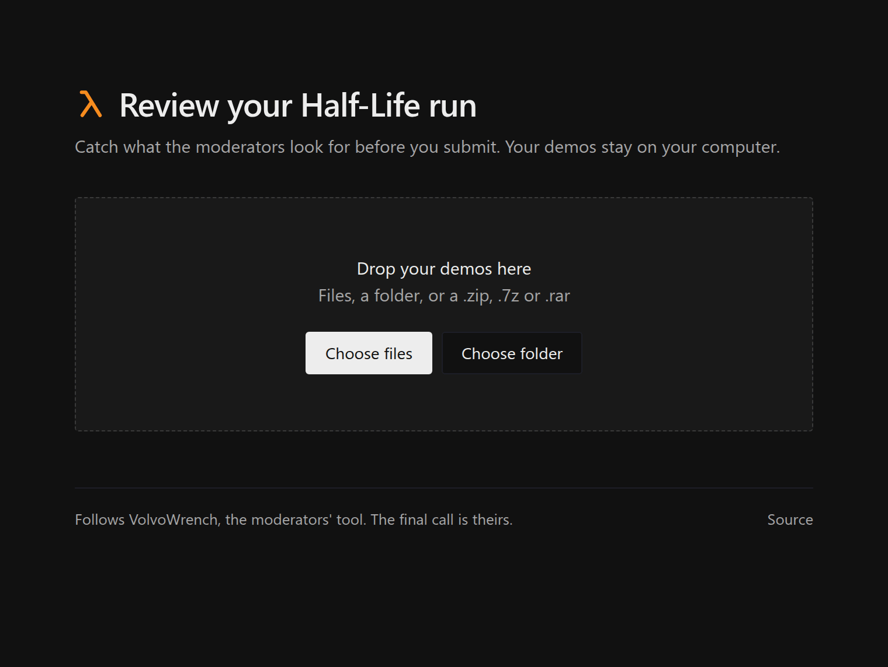

# Preflight

Review your Half-Life speedrun before you submit it. Drop in your demos to see what the moderators look for. It all runs in your browser, so your demos stay on your computer.

https://sansblues.github.io/preflight/

It reads `.dem` files, folders, `.zip`, `.7z` and `.rar`. It finds everything VolvoWrench, the moderators' tool, finds, minus a few of its false alarms, and also catches missing or out-of-order demos. Individual levels are checked against the chapter's official config. Tested on 5,125 demos, including 40 real speedrun.com submissions. The moderators make the final call.

## Licence

MIT
